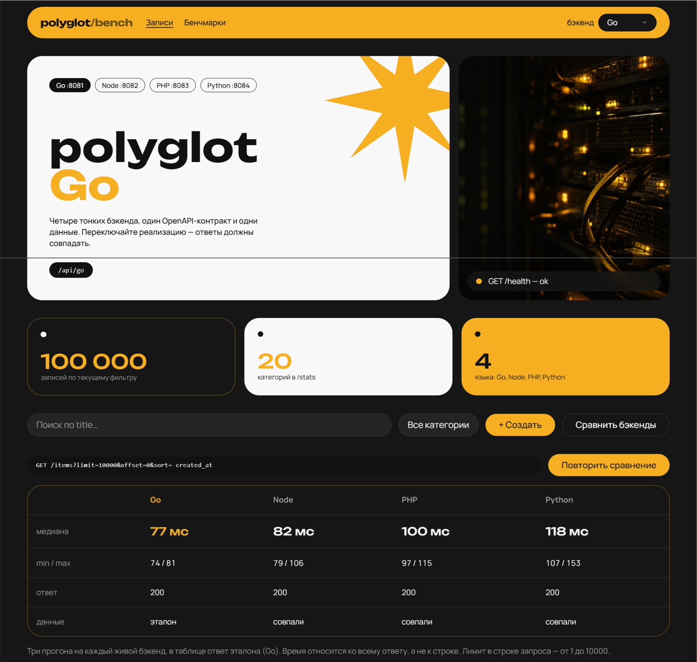
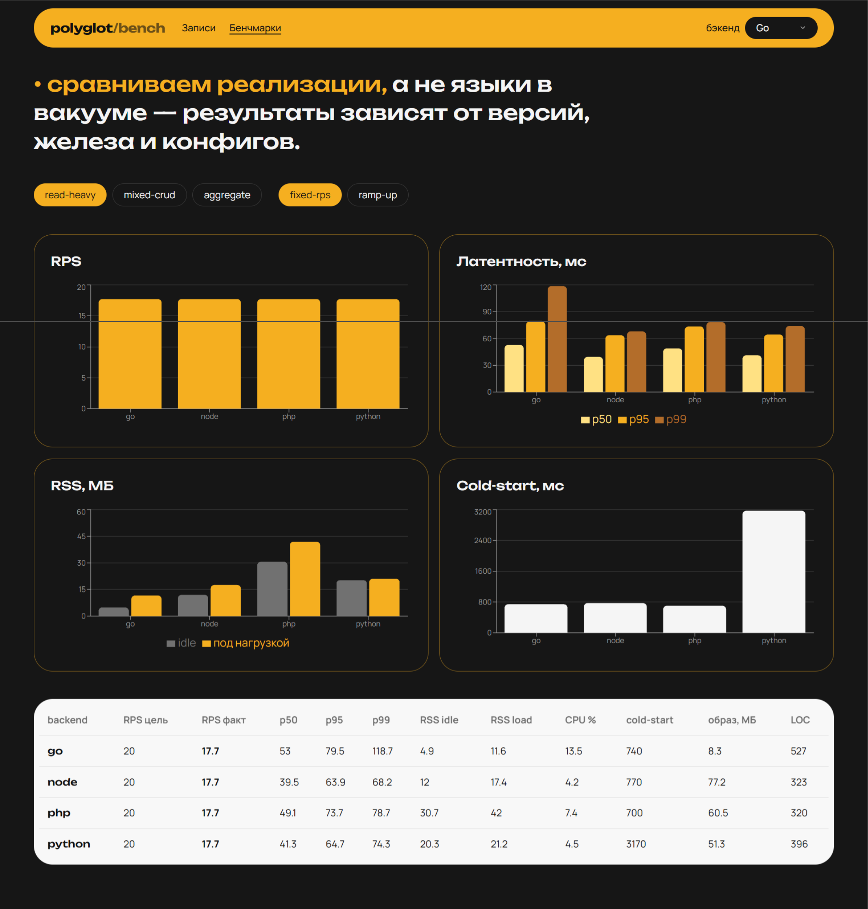

# Polyglot Backend Benchmark

Четыре «тонких» HTTP-сервиса (Go, Node.js, PHP, Python) на одном **OpenAPI**-контракте, одной схеме PostgreSQL и **100 000** детерминированных записей. React-клиент в [`client/`](client/) переключает бэкенд и показывает результаты нагрузочных прогонов.

<p align="center">
  <a href="docs/demo-video.mp4"></a>
</p>
<p align="center">
  <a href="docs/demo-video.mp4"><b>Видео</b></a>
  &nbsp;·&nbsp;
  <a href="docs/screen2.png">полный экран, эталон Go</a>
  &nbsp;·&nbsp;
  <a href="docs/screen3.png">эталон Node</a>
</p>

<p align="center">
  
</p>
<p align="center">Сценарий <b>read-heavy</b>, режим <b>fixed-rps</b>. Цифры на кадрах — демо-статика из репозитория.</p>

## Быстрый старт

```bash
cp .env.example .env   # опционально
make up                # docker compose up -d --build
make smoke             # контрактные проверки на всех 4 бэкендах
```

- UI: http://localhost:8080  
- Бэкенды напрямую (только для отладки): `:8081` Go, `:8082` Node, `:8083` PHP, `:8084` Python  
- Postgres: `localhost:5432` (пароль `polyglot` — **только локальное демо**)

Пересидить БД: `make reseed` (удаляет volume и поднимает заново).

## Архитектура

```text
client (nginx:8080 + SSR node на 127.0.0.1:3000)
  ├── /api/go/      → backend-go:8081
  ├── /api/node/    → backend-node:8082
  ├── /api/php/     → backend-php-nginx:8083  → backend-php:9000 (FPM)
  └── /api/python/  → backend-python:8084
pg: PostgreSQL 16, init из db/01-init.sql → 02-schema → 03-seed
```

**Осознанные компромиссы (честность):**

| Решение | Зачем |
|--------|--------|
| PHP: FPM + nginx sidecar | «голый» PHP без веб-сервера нереалистичен; минимальный идиоматичный стек. |
| Клиент: TanStack Start + SSR | Готовый UI с SSR; снаружи nginx, внутри Node — как у PHP, зафиксировано в методике. |
| `GET /items` | Два запроса: `SELECT` + `COUNT(*)` с одинаковыми фильтрами у всех языков. |
| `price` / `avg_price` | Строки с двумя знаками — без float-погрешностей между рантаймами. |
| Лимиты CPU/RAM | У каждого `backend-*`: **1 CPU, 512 MB** (`deploy.resources` + `cpus`/`mem_limit`). У `pg`: 2 CPU, 2 GB. |

## Контракт

Источник правды: [`contract/openapi.yaml`](contract/openapi.yaml).  
Типы для справки: `make gen-api` → `client/src/lib/schema.d.ts` (клиент использует [`client/src/lib/api.ts`](client/src/lib/api.ts)).

Коды ошибок: `bad_request`, `not_found`, `validation_error`, `internal_error`.

## Бенчмарки

```bash
make bench              # матрица на этой машине: 20 RPS, 1 прогон, прогрев 5 с (~15 мин)
make bench-quick        # один прогон read-heavy / Go, 10 с
make publish-bench      # скопировать bench/results → client/public/bench
```

Тяжелее, на свободной машине: `make bench RPS_TARGET=200 BENCH_RUNS=3 BENCH_DURATION=2m BENCH_WARMUP=30`.

Сценарии: `bench/scenarios/` (k6). По умолчанию:

- прогрев 5 с;
- **fixed-rps** 20 и **ramp-up** до 20;
- read-heavy и mixed-crud по 30 с, aggregate 20 с;
- при `BENCH_RUNS` > 1 в JSON пишется медиана;
- `failed_pct` — доля неуспешных запросов. Если она большая или k6 пишет `Insufficient VUs`, цель по RPS не выдержана: снизьте `RPS_TARGET`;
- JSON: `bench/results/<scenario>-<backend>-<mode>.json`;
- UI читает статику из `client/public/bench/`.

Официальные цифры снимайте на изолированной машине без фонового шума; публичный стенд — для демо UI, не для нагрузки.

### Пример результатов (демо-статика в репозитории)

Пока не выполнен полный `make bench`, в UI могут отображаться эталонные JSON из `client/public/bench/`. После прогона: `make publish-bench` и зафиксируйте железо и дату в этом README.

## Публичный стенд

- [`docker-compose.prod.yml`](docker-compose.prod.yml) — снимает published-порты бэкендов и Postgres, наружу **80→client**.  
- [`deploy/nginx.conf`](deploy/nginx.conf) — rate-limit 10 r/s (burst 20), `limit_conn` 20, тело 16 KB.  
- TLS: Let's Encrypt / Caddy на VPS **2 vCPU / 4 GB RAM** (инструкция у провайдера).

## Make-цели

| Цель | Действие |
|------|----------|
| `up` / `down` / `logs` | Compose lifecycle |
| `reseed` | Пересоздать volume Postgres |
| `smoke` | Контрактные тесты |
| `bench` / `bench-quick` | k6 |
| `publish-bench` | Обновить графики в UI |
| `lint` | golangci-lint, eslint (client), ruff (python) |
| `gen-api` | openapi-typescript |

## CI

GitHub Actions: [`.github/workflows/ci.yml`](.github/workflows/ci.yml) — validate OpenAPI, lint, `docker compose build`, `make smoke`.

## Ограничения

Мы сравниваем **реализации** при фиксированной схеме, данных, пуле (20), лимитах и сценариях — не «языки в вакууме». Результаты зависят от версий PG, драйверов, железа и ОС.

Лицензия: MIT ([`LICENSE`](LICENSE)).
